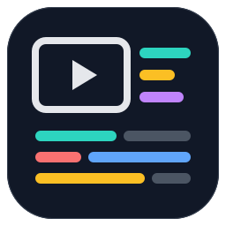
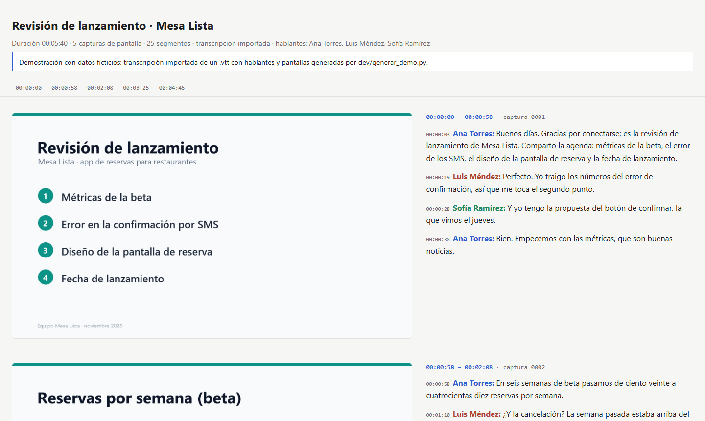

<p align="center">
  
</p>

<h1 align="center">minutas-video</h1>

<p align="center">
  <b>De la grabación de una reunión a una minuta que se puede verificar.</b><br>
  Transcripción local con Whisper · capturas de lo que se mostraba · transcripción ilustrada · minuta con acuerdos y pendientes
</p>

<p align="center">
  <a href="CHANGELOG.md"></a>
  <a href="LICENSE"></a>
  <a href="https://docs.claude.com/en/docs/claude-code"></a>
  <a href="https://www.python.org/"></a>
  <a href="https://docs.astral.sh/uv/"></a>
  <a href="https://github.com/SYSTRAN/faster-whisper"></a>
  <a href="#requisitos"></a>
  <a href="#requisitos"></a>
  <a href="https://github.com/Juliocbm/minutas-video/commits/main"></a>
  <a href="https://github.com/Juliocbm/minutas-video/stargazers"></a>
</p>

<p align="center">
  <picture>
    <source media="(prefers-color-scheme: dark)" srcset="assets/demo-oscuro.png">
    
  </picture>
  <br>
  <sub>Transcripción ilustrada de la <a href="docs/ejemplo/">reunión de ejemplo</a> (datos ficticios) · <a href="docs/ejemplo/minuta.md">su minuta</a></sub>
</p>

---

## ¿Qué hace?

Le pasas a Claude la grabación de una junta y te devuelve:

- **La transcripción** con marcas de tiempo (`.txt` y `.srt`), hecha en tu máquina.
- **Capturas** automáticas cada vez que cambia lo que se muestra en pantalla.
- **Una transcripción ilustrada** en HTML: cada captura junto a lo que se dijo mientras estuvo visible. Así "como ven aquí…" vuelve a tener sentido.
- **Una minuta** con acuerdos, temas y pendientes, cada uno con su minuto y su captura. Si le das documentos relacionados, señala qué cambió la reunión respecto a lo escrito.
- Opcional: **un paquete de contexto** para pegarle lo acordado a otra sesión de Claude, por ejemplo la que implementa lo que se decidió.

Funciona con cualquier grabación: videollamadas (Teams, Zoom, Meet), grabaciones de pantalla (OBS), juntas presenciales o solo audio. No depende de ninguna plataforma.

## Instalación

En Claude Code:

```
/plugin marketplace add Juliocbm/minutas-video
/plugin install minutas-video@minutas-video
```

No hay que instalar nada más a mano: la primera vez, la skill revisa tu equipo y, con tu permiso, instala [uv](https://docs.astral.sh/uv/), que se encarga de Python y de las dependencias.

**Actualizar.** Los plugins de marketplaces de terceros no se actualizan solos. Para traer la versión nueva, desde una terminal:

```
claude plugin marketplace update minutas-video
claude plugin update minutas-video
```

Reinicia Claude Code después. También puedes activar la actualización automática de este marketplace desde el menú `/plugin`.

## Uso

Pídeselo a Claude con tus palabras:

> Procesa la junta que grabé en `C:\Grabaciones\2026-11-05 revisión.mkv` y hazme la minuta.

> Resúmeme rápido esta llamada: `~/Descargas/llamada-proveedor.m4a`

> Aquí está el video y el .vtt que exportó Teams. Compara lo acordado con `docs/analisis.md`.

La skill `procesar-reunion` se activa sola. También puedes invocarla con argumentos:

```
/minutas-video:procesar-reunion "C:\Grabaciones\junta.mkv" --preset completo
```

Si falta algo por decidir, Claude te lo pregunta en una sola ventana de opciones (preset, si usar la transcripción de la plataforma, entregables). Lo que ya dijiste o ya está configurado no lo pregunta.

### Presets

| Preset | Para qué | Transcripción | Capturas | Minuta |
|---|---|---|---|---|
| `rapido` | Lo esencial, cuando hay prisa | large-v3-turbo | No | Corta |
| `estandar` | El uso normal (por defecto) | La mejor para tu equipo | Sí | Completa, con transcripción ilustrada |
| `completo` | Juntas importantes | La mejor para tu equipo | Sí, revisadas todas | Completa, contrastada con documentos y con contexto para otra sesión |
| `audio` | Grabaciones sin video | La mejor para tu equipo | No | Completa |

### Avance y reanudación

- Mientras procesa, Claude te avisa en hitos: "Transcripción al 50 %, faltan ~2 min". Para ver una barra en vivo, corre en tu terminal el comando `seguir` que te indica.
- Si algo falla o se interrumpe, vuelve a pedirlo: lo que ya terminó no se repite. Lo mismo si cambias una opción: solo se rehace lo que depende de ella.

## Entradas y salidas

| Entrada | |
|---|---|
| **Grabación** (obligatoria) | Video (mp4, mkv, mov, webm) o audio (m4a, mp3, wav) |
| Transcripción con nombres | `.vtt`/`.srt` exportado de Teams, Zoom o Meet: aporta quién dijo qué |
| Configuración del proyecto | `.minutas-video/`: preset, glosario de términos y participantes ([ver abajo](#configuración)) |
| Documentos relacionados | Análisis, planes o código para contrastar con lo acordado |

| Salida (en `<grabación>_minuta/`) | Lo genera |
|---|---|
| `transcripcion.txt` · `.srt` · `.json` | Whisper, en local |
| `capturas/` · `capturas.json` | Comparación de imágenes, en local |
| `glosario.json` | Búsqueda de los términos del glosario, en local |
| `transcripcion-ilustrada.html` | Script, en local |
| `reunion.json` · `progreso.json` · `_registro/` | Registro de cada paso, en local |
| `minuta.md` · `contexto-<tema>.md` | Claude |

El detalle de cada formato está en [docs/salidas.md](docs/salidas.md).

## Cómo funciona

- **Whisper** (IA de voz) transcribe en tu GPU o CPU. No necesita internet una vez descargado el modelo.
- **Las capturas no usan IA:** se compara cada segundo del video con la última captura y se guarda cuando el cambio es grande y la imagen ya se estabilizó.
- **Claude** orquesta todo y redacta la minuta: lee la transcripción, revisa las capturas que importan, separa acuerdos de propuestas y contrasta con tus documentos.

Más detalle en [docs/arquitectura.md](docs/arquitectura.md). Los scripts también se pueden [usar sin Claude](docs/uso-sin-claude.md).

## Requisitos

| | |
|---|---|
| **Claude Code** | Para usarlo como plugin |
| **GPU NVIDIA** (opcional) | Unos 5 min por hora de audio con el modelo large-v3. Requiere un driver reciente; las librerías CUDA se instalan solas |
| **Sin GPU** | Funciona en CPU con modelos más chicos (medium o small) |
| **Espacio** | ~3 GB para el modelo large-v3 y ~1.5 GB para las librerías CUDA, descargados una vez |

Probado en Windows 11 con GPU NVIDIA. Los scripts son multiplataforma, pero macOS y Linux aún no se han probado ([backlog](BACKLOG.md)).

## Quién dijo qué

Whisper recibe el audio ya mezclado y no distingue voces. Si la plataforma generó una transcripción con nombres (Teams, Zoom y Meet pueden exportar `.vtt`), dásela junto con el video: la skill la importa con los hablantes exactos. La separación automática de voces está en el [backlog](BACKLOG.md).

## Configuración

Todo es opcional. La forma más cómoda es pedírselo a Claude:

```
/minutas-video:configurar
```

Te pregunta el preset, el idioma y las capturas por defecto, propone un glosario a partir de los documentos de tu proyecto y, si quieres, registra a los participantes habituales. Escribe archivos que puedes editar a mano:

| Archivo | En `~/.minutas-video/` (todos tus proyectos) o `<proyecto>/.minutas-video/` |
|---|---|
| `config.toml` | Preset, idioma, modelo y capturas por defecto |
| `glosario.toml` | Términos del proyecto y cómo los escribe mal la transcripción |
| `participantes.toml` | Nombre, rol y apodos de quienes suelen estar en las reuniones |

Whisper confunde siglas y nombres propios. Con el glosario, cada variante se detecta sola, se anota dónde aparece y la transcripción ilustrada incluye la nota de corrección:

```toml
[terminos]
Kubernetes = ["cubernetes"]
SAP = ["sap", "Sap"]
OKR = []
```

La transcripción queda fiel al audio: forzar el vocabulario dentro de Whisper la degradaba (ver [CHANGELOG](CHANGELOG.md)). El formato completo está en [configuración](skills/procesar-reunion/references/configuracion.md).

## Privacidad

- La transcripción y las capturas se generan en tu equipo.
- Para redactar la minuta, Claude lee la transcripción y algunas capturas, igual que cualquier archivo que le compartes.
- Las salidas contienen el contenido de la reunión: no las guardes en un repositorio público.

## Documentación

- [Arquitectura](docs/arquitectura.md): flujo, qué es IA y qué no, decisiones de diseño.
- [Formato de las salidas](docs/salidas.md).
- [Configuración](skills/procesar-reunion/references/configuracion.md): capas, presets, glosario y participantes.
- [Uso sin Claude](docs/uso-sin-claude.md).
- [Ejemplo completo](docs/ejemplo/): reunión ficticia con todas sus salidas.
- [Solución de problemas](skills/procesar-reunion/references/solucion-problemas.md).
- [CHANGELOG](CHANGELOG.md) · [Backlog y roadmap](BACKLOG.md).

## Desarrollo

```bash
uv run pytest                                          # pruebas de los scripts (sin Whisper)
claude plugin eval . --allow-tools Write Edit Bash --scaffold   # evaluaciones de la skill (Claude Code 2.1.269+)
```

Las evaluaciones están en [`evals/`](evals/) y usan la reunión ficticia como entrada. Son corridas reales del modelo y tienen costo.

## Licencia

[MIT](LICENSE) © Juliocbm
