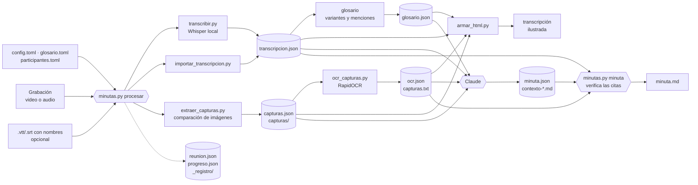

# Arquitectura

minutas-video es un plugin de Claude Code con dos skills:
- `procesar-reunion` se activa sola cuando compartes una grabación.
- `configurar` solo corre si la invocas (`/minutas-video:configurar`).

Una skill son instrucciones (`SKILL.md`) más scripts: Claude lee las instrucciones y sigue el procedimiento.

La división de trabajo es estricta. `minutas.py` hace todo lo mecánico, es reproducible y no gasta tokens. Claude pone el criterio: acordar lo necesario, revisar y redactar.

## Flujo

`minutas.py` corre la transcripción y las capturas en paralelo, cada una en un proceso aparte con sus propias dependencias. En cuanto terminan las capturas, arranca el OCR mientras sigue la transcripción. Después corre el glosario (en el mismo proceso, sin dependencias) y la transcripción ilustrada. Un fallo del OCR no detiene el HTML: sale sin el texto de las capturas.

## Qué es IA y qué no

| Pieza | Tipo | Dónde corre | Costo |
|---|---|---|---|
| `transcribir.py` (Whisper) | IA de reconocimiento de voz | En tu máquina (GPU o CPU) | Gratis; el modelo se descarga una vez |
| `minutas.py` (orquestador, glosario) | No es IA: ordena pasos y busca texto | En tu máquina | Gratis |
| `importar_transcripcion.py` | No es IA: lee subtítulos | En tu máquina | Gratis |
| `extraer_capturas.py` | No es IA: compara imágenes | En tu máquina | Gratis |
| `ocr_capturas.py` (RapidOCR) | IA de reconocimiento de texto en imágenes | En tu máquina (CPU) | Gratis; el modelo viene en el paquete |
| `minutas.py minuta` | No es IA: valida, busca cada cita y arma el Markdown | En tu máquina | Gratis |
| `hojas_contacto.py`, `armar_html.py` | No es IA: arma archivos | En tu máquina | Gratis |
| `minuta.json` y contexto | IA (Claude): entiende, sintetiza y contrasta | En la nube (Anthropic) | Usa tu plan de Claude |

Whisper convierte audio en texto, pero no entiende la reunión. La parte que distingue acuerdos de propuestas, corrige términos y cruza lo dicho con lo que se veía la hace Claude. Por eso el plugin funciona dentro de Claude Code. Los scripts también se pueden usar solos: ver [uso sin Claude](uso-sin-claude.md).

## Decisiones de diseño

- **uv en lugar de un entorno compartido.** Cada script declara sus dependencias en su encabezado (PEP 723) y `uv run --script` crea un entorno aislado. No se toca el Python del sistema ni hay conflictos con otros proyectos. Las librerías CUDA, que pesan cerca de 1.5 GB, solo se agregan con `--with` cuando hay GPU.
- **El audio se decodifica con PyAV dentro del script.** No se usa la función de faster-whisper, porque faster-whisper 1.2.1 pasa a PyAV 19 un parámetro que ya no existe.
- **Sin vocabulario en Whisper.** Pasarle términos con `hotwords` hizo que repitiera la lista, inventara frases en otros idiomas y perdiera la mitad del contenido. La transcripción queda fiel al audio y los términos se corrigen en la minuta.
- **Capturas con espera de estabilidad.** Al detectar un cambio, el script espera a que la imagen deje de moverse antes de capturar. Así evita fotos a media transición o a medio scroll, y filtra animaciones pequeñas como un GIF en una firma de correo.
- **Un formato intermedio** (`transcripcion.json`). Whisper y la importación de subtítulos producen lo mismo, así que el HTML y la minuta no dependen de dónde salió el texto.
- **Un manifiesto por reunión** (`reunion.json`). Cada paso guarda una firma de sus parámetros, del archivo de entrada (tamaño y fecha) y de las firmas de los pasos de los que depende. Si la firma no cambió y el resultado existe, el paso no se repite. Si cambia la transcripción, se rehacen el glosario y el HTML, pero no las capturas. Las opciones pasadas por la línea de comandos se guardan y se reaplican al reanudar esa reunión.
- **El avance como protocolo.** Los scripts largos imprimen líneas `@progreso {json}` cuando los corre `minutas.py`. El orquestador las convierte en barras (si hay terminal), en hitos de texto (si no la hay, como cuando lo lanza Claude), en `progreso.json` y en `_registro/hitos.log`. Claude sigue ese archivo con la herramienta Monitor y avisa en cada hito, sin leer cada línea.
- **Configuración por capas en TOML.** Valores del plugin, preset, usuario (`~/.minutas-video/`), proyecto (`.minutas-video/`, buscado hacia arriba) y corrida. Un valor fijado en un archivo manda sobre el preset. Los errores detienen el proceso con el archivo y la clave, en lugar de ignorarse.
- **El glosario no reescribe la transcripción.** Anota dónde aparece cada variante mal escrita y deja el texto fiel al audio. La corrección se hace en la minuta, con evidencia, y el HTML lleva la nota.
- **Pantallas repetidas por SSIM, sin hash perceptual.** Con una reunión real, las repeticiones dieron una similitud estructural de 0.98 a 0.996 y la pantalla distinta más parecida, 0.95; el hash perceptual daba 3 bits de distancia entre páginas distintas de un mismo documento. La captura repetida se guarda igual, para que un cambio pequeño (un dato en una tabla) no se pierda: solo se evita revisarla y leerla dos veces.
- **OCR en CPU con el modelo del paquete.** RapidOCR 3.10 trae PP-OCRv6 multilingüe (incluye español), así que no descarga modelos ni hace falta un respaldo. Los ajustes por defecto fueron los mejores: reducir la imagen o agrandar los lotes perdía texto o tardaba más. Para leer, `capturas.txt` muestra solo lo nuevo de cada captura: en la reunión real, el 30 % de las líneas.
- **La minuta como datos.** Claude escribe `minuta.json` y un script genera `minuta.md`. Así la evidencia de cada acuerdo es verificable por una máquina: la cita se busca cerca de su momento (con tolerancia a muletillas omitidas, saltos con «…» y términos del glosario) y se reporta lo que no cuadra. El mismo archivo servirá para exportar a otros formatos sin volver a redactar.

## Dónde quedan las cosas

| Qué | Dónde |
|---|---|
| Modelos de Whisper | `~/.cache/huggingface` (o `HF_HOME`) |
| Entornos y paquetes de uv | La caché de uv (`uv cache dir`) |
| Salidas de cada reunión | `<carpeta de la grabación>/<nombre>_minuta/`, o la que indiques |
| Configuración | `~/.minutas-video/` (usuario) y `<proyecto>/.minutas-video/` |
