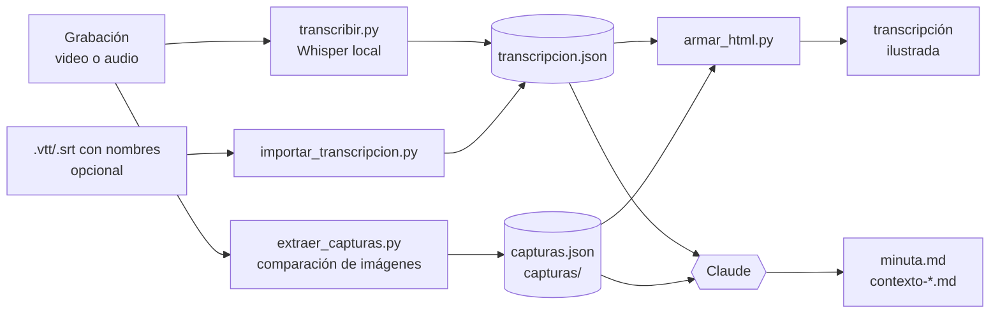

# Arquitectura

minutas-video es un plugin de Claude Code con una sola skill, `procesar-reunion`. Una skill son instrucciones (`SKILL.md`) más scripts: Claude lee las instrucciones cuando le pides procesar una grabación y sigue el procedimiento.

## Flujo

## Qué es IA y qué no

| Pieza | Tipo | Dónde corre | Costo |
|---|---|---|---|
| `transcribir.py` (Whisper) | IA de reconocimiento de voz | En tu máquina (GPU o CPU) | Gratis; el modelo se descarga una vez |
| `importar_transcripcion.py` | No es IA: lee subtítulos | En tu máquina | Gratis |
| `extraer_capturas.py` | No es IA: compara imágenes | En tu máquina | Gratis |
| `hojas_contacto.py`, `armar_html.py` | No es IA: arma archivos | En tu máquina | Gratis |
| Minuta y contexto | IA (Claude): entiende, sintetiza y contrasta | En la nube (Anthropic) | Usa tu plan de Claude |

Whisper convierte audio en texto, pero no entiende la reunión. La parte que distingue acuerdos de propuestas, corrige términos y cruza lo dicho con lo que se veía la hace Claude. Por eso el plugin funciona dentro de Claude Code. Los scripts también se pueden usar solos: ver [uso sin Claude](uso-sin-claude.md).

## Decisiones de diseño

- **uv en lugar de un entorno compartido.** Cada script declara sus dependencias en su encabezado (PEP 723) y `uv run --script` crea un entorno aislado. No se toca el Python del sistema ni hay conflictos con otros proyectos. Las librerías CUDA, que pesan cerca de 1.5 GB, solo se agregan con `--with` cuando hay GPU.
- **El audio se decodifica con PyAV dentro del script.** No se usa la función de faster-whisper, porque faster-whisper 1.2.1 pasa a PyAV 19 un parámetro que ya no existe.
- **Sin vocabulario en Whisper.** Pasarle términos con `hotwords` hizo que repitiera la lista, inventara frases en otros idiomas y perdiera la mitad del contenido. La transcripción queda fiel al audio y los términos se corrigen en la minuta.
- **Capturas con espera de estabilidad.** Al detectar un cambio, el script espera a que la imagen deje de moverse antes de capturar. Así evita fotos a media transición o a medio scroll, y filtra animaciones pequeñas como un GIF en una firma de correo.
- **Un formato intermedio** (`transcripcion.json`). Whisper y la importación de subtítulos producen lo mismo, así que el HTML y la minuta no dependen de dónde salió el texto.

## Dónde quedan las cosas

| Qué | Dónde |
|---|---|
| Modelos de Whisper | `~/.cache/huggingface` (o `HF_HOME`) |
| Entornos y paquetes de uv | La caché de uv (`uv cache dir`) |
| Salidas de cada reunión | `<carpeta de la grabación>/<nombre>_minuta/`, o la que indiques |
