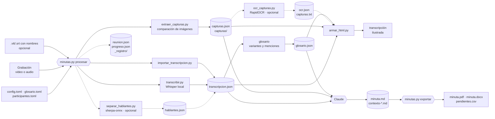

# Arquitectura

minutas-video es un plugin de Claude Code con dos skills:
- `procesar-reunion` se activa sola cuando compartes una grabación.
- `configurar` solo corre si la invocas (`/minutas-video:configurar`).

Una skill son instrucciones (`SKILL.md`) más scripts: Claude lee las instrucciones y sigue el procedimiento.

La división de trabajo es estricta. `minutas.py` hace todo lo mecánico, es reproducible y no gasta tokens. Claude pone el criterio: acordar lo necesario, revisar y redactar.

## Flujo

`minutas.py` corre la transcripción y las capturas en paralelo, cada una en un proceso aparte con sus propias dependencias. Si se piden, la separación de hablantes y el OCR corren después, de uno en uno, porque a la vez se estorban (con una reunión real de 35 minutos, los tres juntos tardaron de 5 a 7 veces más cada uno). Después corre el glosario (en el mismo proceso, sin dependencias) y la transcripción ilustrada. Un fallo de los opcionales no detiene el HTML: sale sin su resultado.

## Qué es IA y qué no

| Pieza | Tipo | Dónde corre | Costo |
|---|---|---|---|
| `transcribir.py` (Whisper) | IA de reconocimiento de voz | En tu máquina (GPU o CPU) | Gratis; el modelo se descarga una vez |
| `minutas.py` (orquestador, glosario) | No es IA: ordena pasos y busca texto | En tu máquina | Gratis |
| `importar_transcripcion.py` | No es IA: lee subtítulos | En tu máquina | Gratis |
| `extraer_capturas.py` | No es IA: compara imágenes | En tu máquina | Gratis |
| `separar_hablantes.py` (sherpa-onnx), opcional | IA de reconocimiento de voces: quién habla, sin nombres | En tu máquina (CPU) | Gratis; los modelos se descargan de GitHub una vez |
| `ocr_capturas.py` (RapidOCR), opcional | IA de reconocimiento de texto en imágenes | En tu máquina (CPU) | Gratis; el modelo viene en el paquete |
| `minutas.py minuta`, opcional | No es IA: valida `minuta.json`, busca cada cita y arma el Markdown | En tu máquina | Gratis |
| `minutas.py exportar`, `exportar_docx.py` | No es IA: arma PDF (con Edge o Chrome), Word y CSV | En tu máquina | Gratis |
| `hojas_contacto.py`, `armar_html.py` | No es IA: arma archivos | En tu máquina | Gratis |
| `minuta.md` y contexto | IA (Claude): entiende, sintetiza y contrasta | En la nube (Anthropic) | Usa tu plan de Claude |

Whisper convierte audio en texto, pero no entiende la reunión. La parte que distingue acuerdos de propuestas, corrige términos y cruza lo dicho con lo que se veía la hace Claude. Por eso el plugin funciona dentro de Claude Code. Los scripts también se pueden usar solos: ver [uso sin Claude](uso-sin-claude.md).

## Decisiones de diseño

- **Medir de punta a punta antes de sumar.** Entre la 0.2 y la 0.4 se agregaron OCR, separación de hablantes y una minuta con citas verificadas, cada pieza medida por separado. Al comparar la minuta final contra la de la 0.1 (dos reuniones reales, sesión limpia, calificación a ciegas contra una lista de hechos), la exactitud quedó empatada: una reunión la ganó cada versión. La 0.4 tardaba de 8 a 13 minutos más y, al apoyarse en el texto del OCR, Claude dejó de mirar las pantallas y perdió detalles. Por eso la 0.5 vuelve al flujo de la 0.1 (Claude mira las hojas de miniaturas y escribe `minuta.md`) y deja OCR y hablantes como opciones. Cualquier cambio que toque la minuta se mide igual antes de publicarse, con [`dev/medir-minuta/`](../dev/medir-minuta/LEEME.md).
- **uv en lugar de un entorno compartido.** Cada script declara sus dependencias en su encabezado (PEP 723) y `uv run --script` crea un entorno aislado. No se toca el Python del sistema ni hay conflictos con otros proyectos. Las librerías CUDA, que pesan cerca de 1.5 GB, solo se agregan con `--with` cuando hay GPU.
- **El audio se decodifica con PyAV dentro del script.** No se usa la función de faster-whisper, porque faster-whisper 1.2.1 pasa a PyAV 19 un parámetro que ya no existe.
- **Sin vocabulario en Whisper.** Pasarle términos con `hotwords` hizo que repitiera la lista, inventara frases en otros idiomas y perdiera la mitad del contenido. La transcripción queda fiel al audio y los términos se corrigen en la minuta.
- **Capturas con espera de estabilidad.** Al detectar un cambio, el script espera a que la imagen deje de moverse antes de capturar. Así evita fotos a media transición o a medio scroll, y filtra animaciones pequeñas como un GIF en una firma de correo.
- **Un formato intermedio** (`transcripcion.json`). Whisper y la importación de subtítulos producen lo mismo, así que el HTML y la minuta no dependen de dónde salió el texto.
- **Un manifiesto por reunión** (`reunion.json`). Cada paso guarda una firma de sus parámetros, del archivo de entrada (tamaño y fecha) y de las firmas de los pasos de los que depende. Si la firma no cambió y el resultado existe, el paso no se repite. Si cambia la transcripción, se rehacen el glosario y el HTML, pero no las capturas. Las opciones pasadas por la línea de comandos se guardan y se reaplican al reanudar esa reunión.
- **El avance como protocolo.** Los scripts largos imprimen líneas `@progreso {json}` cuando los corre `minutas.py`. El orquestador las convierte en barras (si hay terminal), en hitos de texto (si no la hay, como cuando lo lanza Claude), en `progreso.json` y en `_registro/hitos.log`. Claude no sigue el avance: cada aviso despertaría la sesión y gastaría tokens (en una reunión de 35 minutos fueron 14 turnos de espera). Espera la notificación de que terminó; quien quiera ver el avance corre `minutas.py seguir`.
- **Configuración por capas en TOML.** Valores del plugin, preset, usuario (`~/.minutas-video/`), proyecto (`.minutas-video/`, buscado hacia arriba) y corrida. Un valor fijado en un archivo manda sobre el preset. Los errores detienen el proceso con el archivo y la clave, en lugar de ignorarse.
- **El glosario no reescribe la transcripción.** Anota dónde aparece cada variante mal escrita y deja el texto fiel al audio. La corrección se hace en la minuta, con evidencia, y el HTML lleva la nota.
- **Pantallas repetidas por SSIM, sin hash perceptual.** Con una reunión real, las repeticiones dieron una similitud estructural de 0.98 a 0.996 y la pantalla distinta más parecida, 0.95; el hash perceptual daba 3 bits de distancia entre páginas distintas de un mismo documento. La captura repetida se guarda igual, para que un cambio pequeño (un dato en una tabla) no se pierda: solo se evita revisarla y leerla dos veces.
- **OCR en CPU con el modelo del paquete (opcional).** RapidOCR 3.10 trae PP-OCRv6 multilingüe (incluye español), así que no descarga modelos ni hace falta un respaldo. Los ajustes por defecto fueron los mejores: reducir la imagen o agrandar los lotes perdía texto o tardaba más. Para leer, `capturas.txt` muestra solo lo nuevo de cada captura: en la reunión real, el 30 % de las líneas. Sirve para buscar y copiar valores exactos, no para reemplazar las imágenes: no dice quién habla en la videollamada ni qué está resaltado.
- **Hablantes con sherpa-onnx, sin cuentas (opcional).** Todos los modelos de pyannote en Hugging Face piden cuenta, aceptar condiciones y token: cada usuario del plugin tendría que abrir una cuenta. sherpa-onnx publica en GitHub el modelo de segmentación de pyannote 3.0 convertido (licencia MIT) y varios modelos de voces. Medido con el corpus AMI (`dev/medir_hablantes.py`, mismo protocolo que pyannote): TitaNet small empató al mejor modelo de voces y fue el más rápido (unas 9-11 veces el tiempo real en CPU). Sin decir cuántos hablan, con umbral 1.0 y absorbiendo los "hablantes" de menos de 15 s, el error fue 23.1 % en cuatro reuniones; dar el número real dio 31.7 %, así que no se pregunta. pyannote community-1 publica 17.0 %: la diferencia es sobre todo habla encimada, que casi no cambia a quién se asigna cada frase.
- **La separación no reescribe la transcripción.** `hablantes.json` guarda los turnos; al leer `transcripcion.json`, cada segmento recibe el hablante con el que más se traslapa. Así, apagar la separación o ponerle nombres a los hablantes no obliga a transcribir de nuevo.
- **El reproductor enlaza, no copia.** Chrome y Edge reproducen desde el disco las grabaciones `.mkv` de OBS (H.264 y AAC) y saltan a cualquier minuto al instante, así que el HTML apunta a la grabación con una ruta relativa. Copiarla o convertirla duplicaría cientos de megabytes por reunión.
- **Búsqueda sin dependencias.** Para unos cientos de frases bastan unas líneas de JavaScript (todas las palabras, sin acentos), y la API de resaltado de CSS marca las palabras sin tocar el HTML. Una biblioteca de búsqueda no aportaba nada a ese tamaño.
- **Exportar sin enlaces.** El PDF y el Word se mandan a otras personas, que no tienen la transcripción ilustrada: los minutos y las capturas van como texto. Ambos salen de `minuta.md`, quitando los enlaces, para que digan lo mismo; el CSV toma la tabla de pendientes. El PDF lo imprime el navegador; el Word, python-docx.
- **La minuta verificada, opcional.** `minutas.py minuta` valida un `minuta.json` y busca cada cita cerca de su momento (con tolerancia a muletillas omitidas, saltos con «…» y términos del glosario). Comprueba que la cita exista, no que se haya interpretado bien: en la comparación no redujo errores y costaba de 0.15 a 0.73 USD más por reunión. Queda para quien la quiera ([formato](minuta-verificada.md)).

## Dónde quedan las cosas

| Qué | Dónde |
|---|---|
| Modelos de Whisper | `~/.cache/huggingface` (o `HF_HOME`) |
| Entornos y paquetes de uv | La caché de uv (`uv cache dir`) |
| Salidas de cada reunión | `<carpeta de la grabación>/<nombre>_minuta/`, o la que indiques |
| Configuración | `~/.minutas-video/` (usuario) y `<proyecto>/.minutas-video/` |
